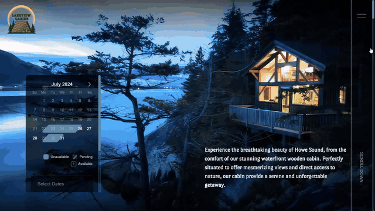
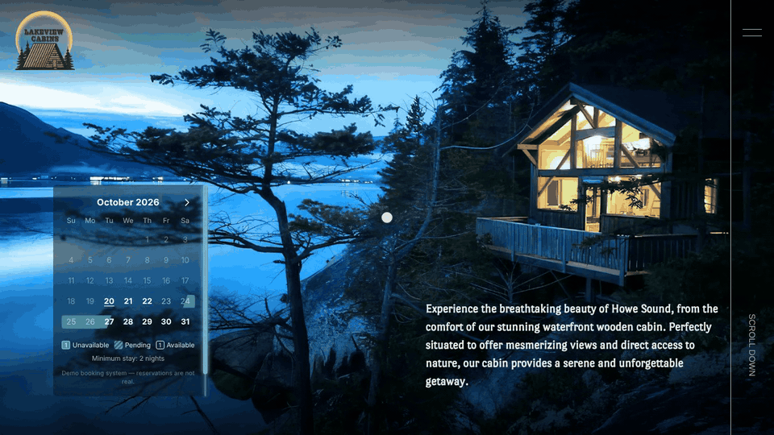

# Lakeview Cabins

A marketing site and booking system for a waterfront timber cabin on Howe Sound, near Squamish, BC.
Guests check availability, pick dates and request a stay. The payment is reserved on their card through Stripe
and only charged once staff approve the request in the dashboard.

**Live demo:** [lakeview-cabins.vercel.app](https://lakeview-cabins.vercel.app) · staff dashboard at
[/staff](https://lakeview-cabins.vercel.app/staff) (the demo login is shown on the sign-in page)

> **Portfolio project.** The booking system runs in demo mode: reservations are not real, payments use Stripe
> test mode, and the data resets every night.



## Highlights

- **Scroll-driven road animation.** A car drives down a winding road while the page scrolls, switching from day
  to night halfway down. It is a 330-frame WebP sequence drawn on a `<canvas>` with GSAP
  ScrollTrigger.
- **No double bookings.** The database itself refuses to save two stays with overlapping dates, even if two
  guests submit the same dates at the same moment. This is a Postgres exclusion constraint
  (`EXCLUDE USING gist (stay WITH &&)`), so it doesn't depend on the app's own checks.
- **Holds and payments.** Sending a request holds the dates while the guest pays on Stripe Checkout. At this
  point Stripe only reserves the money on the card (manual capture). Stripe reports this back to the site through
  a webhook; the site checks each report's signature, so it can't be faked, and handles a repeated report only
  once. The card is charged only when staff approve. If the guest never pays, the hold expires on its own and the
  dates free up.
- **Staff dashboard.** Staff approve a request (the card is charged), decline or cancel it (the reserved money
  goes back to the guest), add bookings themselves, block dates, and see everything on a month calendar.
- **Booking emails.** Guests and the owner get status emails through Gmail SMTP.
- **One booking state, two layouts.** The booking calendar appears twice: in the hero and in the "Book now"
  popup. Both share a TanStack Query cache and a small Zustand store, so dates picked in the hero calendar are
  already selected when the popup opens, and the other way round.
- **Accessible UI.** Popups are built on the browser's own `<dialog>` element, so focus and the Escape key work
  as expected. The calendar and the photo viewer can be used with the keyboard alone, and animations calm down
  for visitors whose device is set to reduce motion (`prefers-reduced-motion`).

## Tech stack

| Area                 | Tools                                                              |
| -------------------- | ------------------------------------------------------------------ |
| Framework            | Next.js 16 (App Router, Cache Components), React 19, TypeScript    |
| Styling              | CSS Modules, self-hosted fonts via Fontsource                      |
| Client data          | TanStack Query, Axios, Zustand                                     |
| Forms and validation | React Hook Form, Zod (one schema shared by client and server)      |
| Animation            | GSAP + ScrollTrigger                                               |
| Database             | Postgres on Neon, postgres.js, plain SQL migrations                |
| Auth                 | Auth.js (credentials, JWT sessions) for the staff dashboard        |
| Payments             | Stripe Checkout (test mode only; live keys are refused)            |
| Email                | Nodemailer over Gmail SMTP                                         |
| Testing              | Vitest (booking rules, service, database), Playwright (end-to-end) |
| Tooling              | ESLint, Prettier                                                   |
| Hosting              | Vercel (with a daily cron job)                                     |

## Getting started

Requirements: Node 20+ and a Postgres database (a free Neon database works).

```bash
npm install
cp .env.example .env.local   # then fill in DATABASE_URL and AUTH_SECRET at minimum
npm run db:migrate
npm run db:seed              # sample bookings + the demo staff account
npm run dev
```

Open http://localhost:3000 for the site and http://localhost:3000/staff for the dashboard. In demo mode the
login page shows the demo staff credentials.

Without Stripe keys, booking requests skip payment and are confirmed straight away. Without Gmail settings, no
emails are sent. Everything else works locally without either.

### Environment variables

See [`.env.example`](.env.example) for the full list with notes. The essentials:

| Variable                                     | Purpose                                                       |
| -------------------------------------------- | ------------------------------------------------------------- |
| `DATABASE_URL`                               | Postgres connection string (use Neon's pooled URL on Vercel)  |
| `AUTH_SECRET`                                | Signs staff sessions                                          |
| `STRIPE_SECRET_KEY`, `STRIPE_WEBHOOK_SECRET` | Stripe test-mode payments                                     |
| `CRON_SECRET`                                | Protects the daily maintenance job                            |
| `DEMO_MODE`                                  | `true` resets to sample data nightly and shows the demo login |
| `GMAIL_USER`, `GMAIL_APP_PASSWORD`           | Booking emails (optional)                                     |

## Scripts

| Command                                  | What it does                                                   |
| ---------------------------------------- | -------------------------------------------------------------- |
| `npm run dev`                            | Start the dev server                                           |
| `npm run build`                          | Apply migrations (and seed an empty demo database), then build |
| `npm test`                               | Unit and integration tests (Vitest)                            |
| `npm run test:e2e`                       | End-to-end tests (Playwright, desktop and phone)               |
| `npm run lint` / `npm run typecheck`     | ESLint / TypeScript                                            |
| `npm run db:migrate` / `npm run db:seed` | Database setup                                                 |

## Project structure

```
src/
  app/
    (site)/          Public pages: home, gallery, customer reviews, privacy
    staff/           Staff dashboard (protected by src/proxy.ts)
    api/             Booking, calendar, Stripe webhook, newsletter and cron routes
  components/
    home/            Hero, info strip, story section with the road animation, closing scene
    booking/         Calendar, guest form, confirmation, queries and shared store
    gallery/         Mosaic, full gallery and photo viewer
    site/            Header and menu, footer, popups, shared pieces
  content/           Page text and image lists
  lib/
    booking/         Dates, pricing rules, availability and the booking service
    payments/        Stripe integration (test mode guard)
    email/           Email templates and sending
    server/          Database client, rate limiting, HTTP helpers
migrations/          SQL migrations
tests/               Vitest suites
e2e/                 Playwright tests
```

## How a booking works



_Recorded locally without Stripe keys, so the request is confirmed straight away instead of going through Stripe Checkout._

1. The calendar asks the server which dates are taken (`/api/calendar`). It gets dates only, never guest
   details.
2. The guest picks dates and sends the form. The site saves the request as `pending`, which holds those dates,
   and sends the guest to Stripe Checkout. Stripe reserves the money on the card but doesn't charge it yet.
3. Stripe tells the site the payment is reserved (webhook), and the guest gets a "request received" email.
4. Staff open the request in the dashboard. Approving it charges the card; declining it releases the reserved
   money back to the guest. Either way, the guest gets an email.
5. Once a day an automatic job (a cron job) frees dates held by requests that were never paid, removes old
   guests' personal details and, in demo mode, resets the sample data.

## Author

Built by **Victor Tar** · [LinkedIn](https://www.linkedin.com/in/viktor-tar/) ·
[GitHub](https://github.com/viktor-tar). Developed with AI-assisted tooling (Claude Code).
